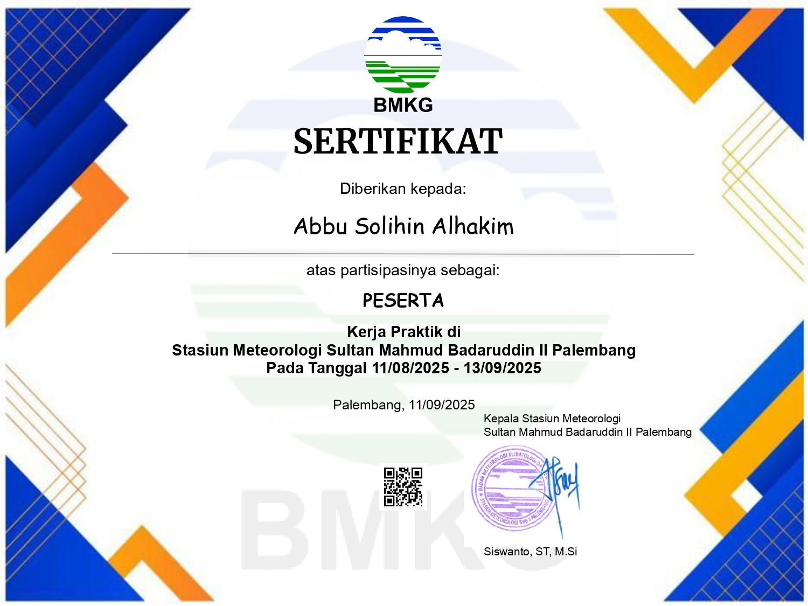

# Meteosphere

  

## About

**Meteosphere** is a web-based weather visualization platform developed during my internship at **BMKG South Sumatra**.

The platform was designed to make weather and disaster information easier to explore through interactive maps, real-time weather data, forecasts, and visual analysis.

The project combines **Next.js, BMKG APIs, OpenStreetMap, and modern web technologies** to create an interactive interface for exploring weather conditions in and around Palembang.

---

## Internship

This project was developed as part of my internship at:

**Badan Meteorologi, Klimatologi, dan Geofisika (BMKG) — South Sumatra**

**Division:** Information and Telecommunication (TIK)
**Internship Period:** August 11 – September 13, 2025
**Project:** Meteosphere — Weather Visualization Platform

The internship provided an opportunity to apply web development knowledge to a real-world meteorological information system.

---

## Features

### Interactive Weather Map

Meteosphere provides an interactive map for exploring weather information using **OpenStreetMap** and meteorological data sources.

Users can explore different weather conditions through map-based visualization.

### Weather Visualization

The platform presents weather information through visual layers and data-driven interfaces, including:

* Rainfall intensity
* Wind conditions
* Temperature distribution
* Weather conditions
* Weather forecasts
* Atmospheric information

### Disaster Information

Meteosphere also integrates disaster-related information to help users monitor events such as earthquake activity.

### Weather Forecast

Users can view weather forecasts and related atmospheric information through a structured interface designed for easier interpretation.

### AI-Powered Voice Presentation

The platform integrates **ElevenLabs** to provide AI-powered voice presentations for weather information.

This feature was designed to make meteorological information more accessible and engaging for users.

---

## Technologies

---

## Tech Stack

* **Next.js** — Application framework
* **React** — User interface
* **Tailwind CSS** — Styling and responsive interface
* **OpenStreetMap** — Interactive geographic mapping
* **BMKG API** — Meteorological and disaster data
* **ElevenLabs** — AI-powered text-to-speech
* **JavaScript / TypeScript** — Application development

---

## Project Goals

The primary goal of Meteosphere was to improve the way meteorological information is presented to users.

Instead of relying primarily on textual weather information, the platform combines:

**Data → Maps → Visualization → Analysis → Voice**

This approach allows users to understand weather conditions through multiple forms of information and interaction.

---

## Development Experience

Developing Meteosphere during my internship introduced me to the challenges of building an application around real-world meteorological data.

The project required consideration of:

* External API integration
* Geographic data visualization
* Interactive map layers
* Real-time weather information
* Responsive interface design
* Data presentation and readability
* Third-party service integration

This experience strengthened my understanding of how frontend applications can transform complex datasets into interfaces that are easier for users to understand.

---

## Project Links

**Live Website:**
https://web-analisis-cuaca-xy5f.vercel.app

**Source Code:**
https://github.com/hakimxiao/magang-web-analisis-cuaca

---

## Acknowledgement

This project was developed during my internship at **BMKG South Sumatra** as part of my practical experience in web development.

I am grateful for the opportunity to work with real meteorological data and to develop a system that focuses on improving the accessibility and visualization of weather information.

---

  <i>Visualizing weather data through technology.</i>

